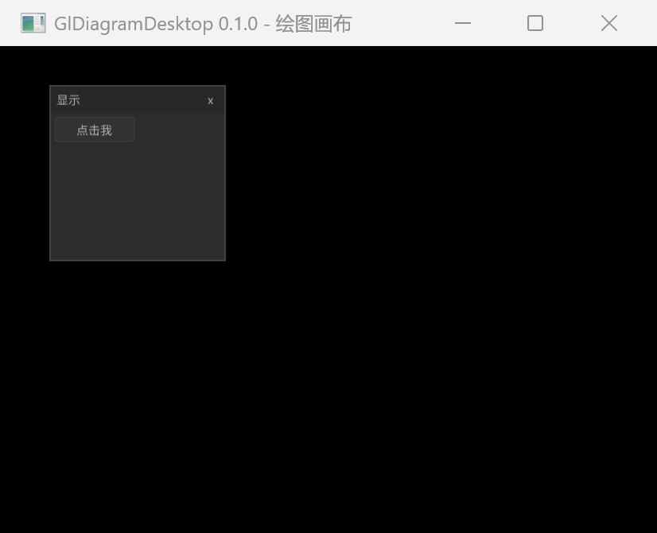

# GlDiagramDesktop

A small Chinese-first C11 + OpenGL 3.3 + Nuklear desktop skeleton.

基于 OpenGL 3.3 与 Nuklear 即时模式 GUI 的中文桌面骨架。仓库名与远程地址为 `gl-diagram-desktop`，构建产物与公共头目录使用 `gldiagramdesktop` 命名空间。

**状态**：v0.1.0（2026-10-23）· MIT · C11 + OpenGL 3.3 + Nuklear · 可运行骨架 · Windows / macOS / Linux 预编译包

> **当前范围**：v0.1.0 是可运行骨架——打开 800×600 的 OpenGL 3.3 Core 窗口，显示一个中文 Nuklear「显示」面板与「点击我」按钮；**尚无绘图画布、图元、连线、保存或导出**。

[](https://github.com/HestiaLab/gl-diagram-desktop/actions/workflows/ci.yml)
[](https://github.com/HestiaLab/gl-diagram-desktop/actions/workflows/static-analysis.yml)
[](https://github.com/HestiaLab/gl-diagram-desktop/releases/tag/v0.1.0)
[](LICENSE)

[下载 v0.1.0](https://github.com/HestiaLab/gl-diagram-desktop/releases/tag/v0.1.0) · [快速开始](#快速开始) · [CMake 与构建](docs/guides/cmake.md) · [贡献](CONTRIBUTING.md) · [许可](LICENSE)



本项目只提供中文文档与中文界面，不再维护英文版本。

## 快速开始

前置：CMake 3.21+、Ninja、C11 编译器（MSVC、GCC、Clang 或 AppleClang）、支持 OpenGL 3.3 的显卡驱动；首次 configure 需要网络拉取 GLFW 3.3.9（离线可用 `FETCHCONTENT_SOURCE_DIR_GLFW`）。Linux 还需要 OpenGL 与 X11 开发包，macOS 需要 Xcode Command Line Tools。详见[环境配置](docs/guides/environment.md)。

首次检出先运行 bootstrap，它会检查工具链并完成一次 configure：

**Windows PowerShell**

```powershell
./scripts/bootstrap.ps1
```

**Linux/macOS**

```sh
./scripts/bootstrap.sh
```

日常检查与构建：

```powershell
./scripts/check.ps1
```

```sh
./scripts/check.sh
```

手动执行 CMake 命令：

```sh
cmake --preset ninja-debug
cmake --build --preset ninja-debug
ctest --preset ninja-debug --output-on-failure
```

本机实测（Windows 11 + MSYS2 UCRT64 GCC 16.2.0 + CMake 4.3.3 + Ninja 1.13.2）：

```console
$ ./build/ninja-debug/bin/gldiagramdesktop.exe --version
gldiagramdesktop 0.1.0

$ ctest --preset ninja-debug --output-on-failure
...
4/6 Test #4: gldiagramdesktop_version_consistency ...   Passed    0.09 sec
5/6 Test #5: gldiagramdesktop_docs_check ............   Passed    0.22 sec
6/6 Test #6: gldiagramdesktop_cpack_config ..........   Passed    0.04 sec

100% tests passed, 0 tests failed out of 6
```

（`ctest` 的 `Test project` 行包含本机路径，已省略；前 3 个用例为 `decl_def_check`、`gate_behaviors`、`version_tests`，全部通过。）

运行应用：

```sh
# Windows
./build/ninja-debug/bin/gldiagramdesktop.exe

# Linux/macOS
./build/ninja-debug/bin/gldiagramdesktop
```

运行后应看到标题为 `GlDiagramDesktop 0.1.0 - 绘图画布` 的 800×600 窗口；当前只有「显示」面板与「点击我」按钮。

命令行参数：

```text
-h, --help     显示帮助
-v, --version  显示版本号
```

## 环境要求

- CMake 3.21 或更高版本。
- Ninja（默认 preset）与 C11 编译器（MSVC、GCC、Clang、AppleClang）。
- 支持 OpenGL 3.3 的显卡驱动。
- 首次配置需要网络：GLFW 3.3.9 通过 FetchContent 获取；离线环境可用
  `FETCHCONTENT_SOURCE_DIR_GLFW` 指向本地 GLFW 源码。

Linux 还需要 OpenGL 与 X11 开发包，macOS 需要 Xcode Command Line Tools。
详见 [环境配置](docs/guides/environment.md)。

## 项目结构

```text
include/gldiagramdesktop/   公共 API（应用入口与版本查询）
src/                        应用实现
src/gldiagramdesktop/       私有实现与平台适配
third_party/                vendored GLAD、KHR、Nuklear（不参与项目警告）
tests/                      CTest 测试（Unity）
cmake/                      CMake 模块
scripts/                    本地引导、检查与质量门禁脚本
docs/                       中文项目文档
res/                        Windows 版本资源与界面字体
assets/                     界面截图
```

## 界面字体

界面使用随包分发的 Noto Sans SC Regular（SIL OFL 1.1），启动时按 CJK 基本区
烘焙图集。字体位于可执行文件同级的 `fonts/` 目录；可用
`GLDIAGRAMDESKTOP_FONT` 环境变量指定其他字体文件。字体来源与再生成方式见
[res/fonts/README.md](res/fonts/README.md)。

## 安装

预编译包见 [Releases v0.1.0](https://github.com/HestiaLab/gl-diagram-desktop/releases/tag/v0.1.0)（Windows x64、macOS arm64、Linux x86_64）。从源码安装：

```sh
cmake --preset ninja-release
cmake --build --preset ninja-release
cmake --install build/ninja-release --prefix install
```

安装内容包括可执行文件、`bin/fonts/` 下的界面字体与文档。本项目是纯应用，
不导出库或 CMake 包。

## 文档

- [CMake 与构建](docs/guides/cmake.md)
- [测试与质量门禁](docs/guides/testing.md)
- [编码规范](docs/guides/coding-style.md)
- [环境配置](docs/guides/environment.md)
- [发布流程](docs/guides/release.md)
- [架构决策记录](docs/adr/README.md)
- [工具链策略 ADR](docs/adr/0001-c11-cmake-toolchain-policy.md)
- [应用型适配 ADR](docs/adr/0002-application-shape.md)
- [工程标准](C_PROJECT_STANDARD.md)
- [贡献指南](CONTRIBUTING.md)
- [安全策略](SECURITY.md)

## 许可证

MIT，见 [LICENSE](LICENSE)。界面字体另受 SIL Open Font License 1.1 约束。
